<div align="center">

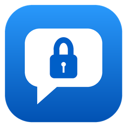

# AI Chat Vault

**Back up, restore and read your Antigravity, Codex and Claude Code chats,
so formatting your PC never costs you your AI project history.**

[](https://github.com/Tauquirshayaan/ai-chat-vault/releases/latest)
[](https://github.com/Tauquirshayaan/ai-chat-vault/actions/workflows/release.yml)
[](LICENSE)


[**Download**](https://github.com/Tauquirshayaan/ai-chat-vault/releases/latest) ·
[Quick start](#quick-start) ·
[How it works](#how-it-works) ·
[FAQ](#faq)

<br>

<picture>
  <source media="(prefers-color-scheme: dark)" srcset="docs/screenshots/backup-dark.png">
  <source media="(prefers-color-scheme: light)" srcset="docs/screenshots/backup-light.png">
  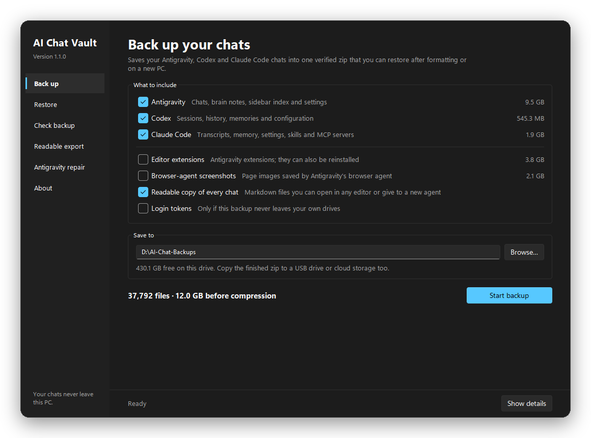
</picture>

</div>

## Why

Your coding agents keep their conversations, plans and memory **on your PC**,
spread over hidden folders. Format Windows and they are gone, along with every
explanation you gave them about your projects.

AI Chat Vault collects all of it into **one verified zip**, puts it back after
you reinstall, and also writes every chat as **readable Markdown**, so a new
agent can catch up on a project without you starting from zero.

## Features

| | |
|---|---|
| **One-click backup** | Antigravity, Codex and Claude Code in a single zip, with live sizes and per-tool choices |
| **Verified** | A SHA-256 checksum for every file, checked after writing and again before restoring |
| **Safe for live databases** | SQLite files are copied with SQLite's own backup API, including data still in `-wal` files |
| **Reversible restore** | Anything a restore would replace is saved first in a restorable "before-restore" zip |
| **Readable copy** | Every chat as Markdown, grouped by project, plus a prompt to brief a new agent |
| **Private by design** | Works offline with no network code; login tokens are left out unless you include them |
| **Antigravity sidebar repair** | Rebuilds a broken chat list while keeping titles and project links, with undo |
| **Window or command line** | A modern desktop app that follows light/dark mode, and a full CLI for scripts |

## Tour

<div align="center">
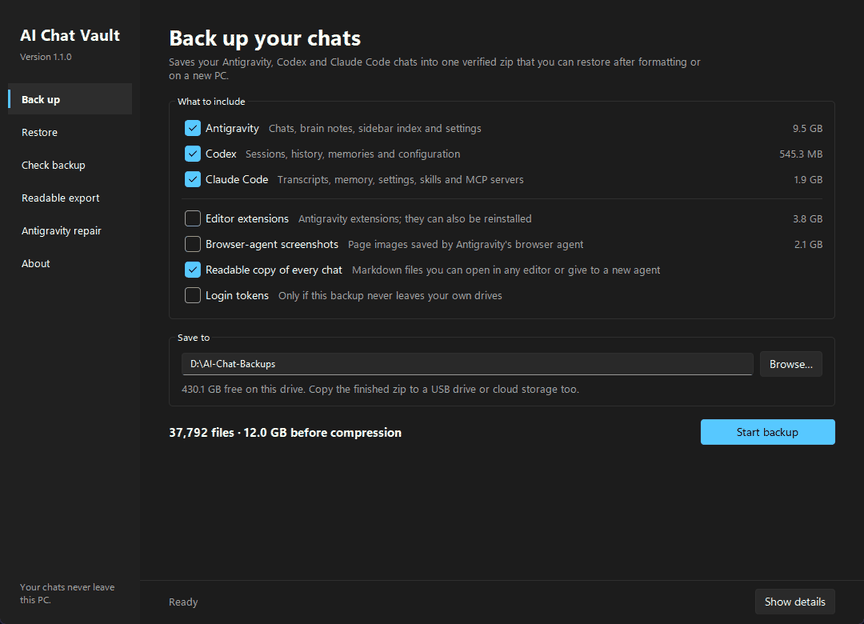
</div>

<table>
<tr>
<td width="50%">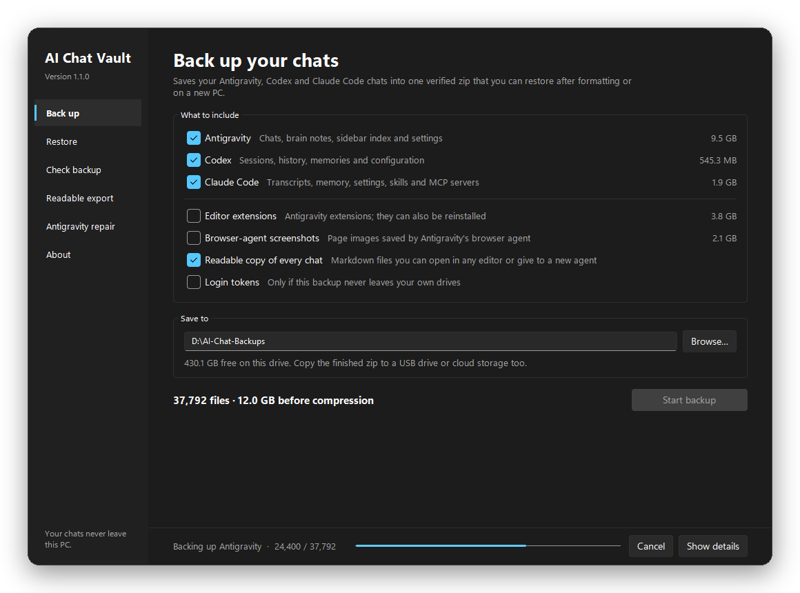<p align="center"><b>Backup</b> with progress and Cancel</p></td>
<td width="50%">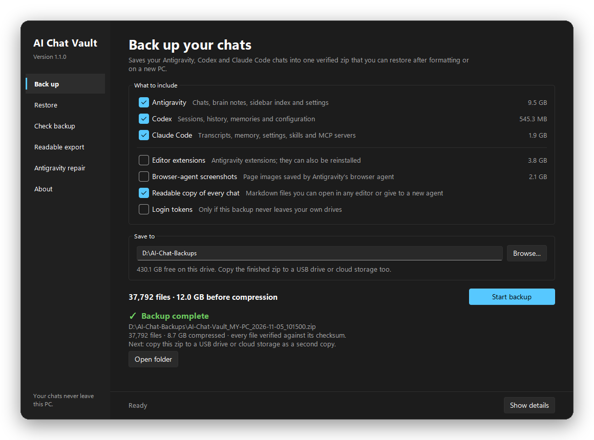<p align="center"><b>Done</b>: every file verified</p></td>
</tr>
<tr>
<td>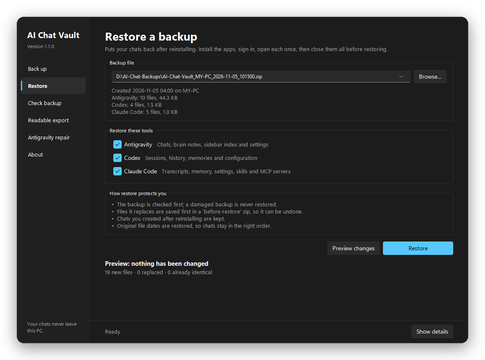<p align="center"><b>Restore</b>: see what's inside, preview, restore</p></td>
<td>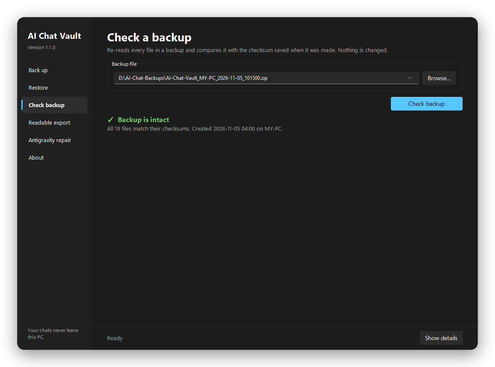<p align="center"><b>Check</b> any backup at any time</p></td>
</tr>
<tr>
<td>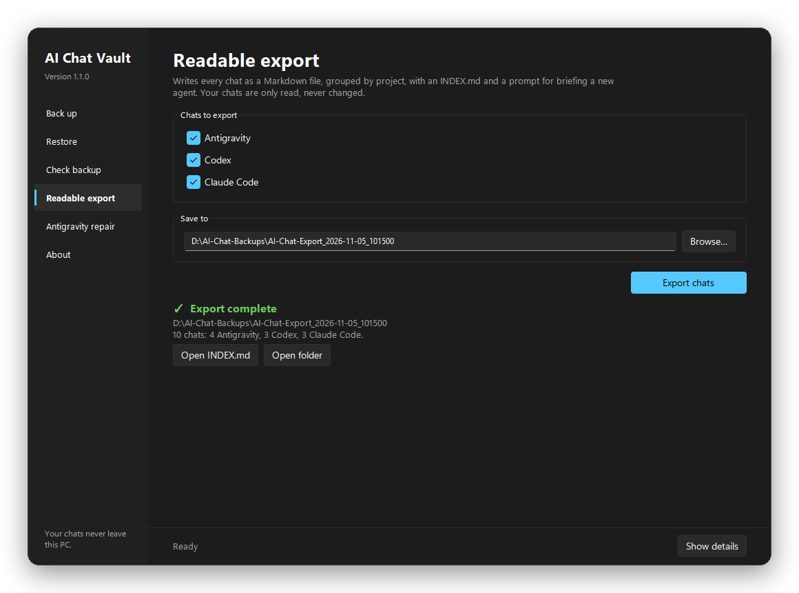<p align="center"><b>Readable export</b> of every chat</p></td>
<td>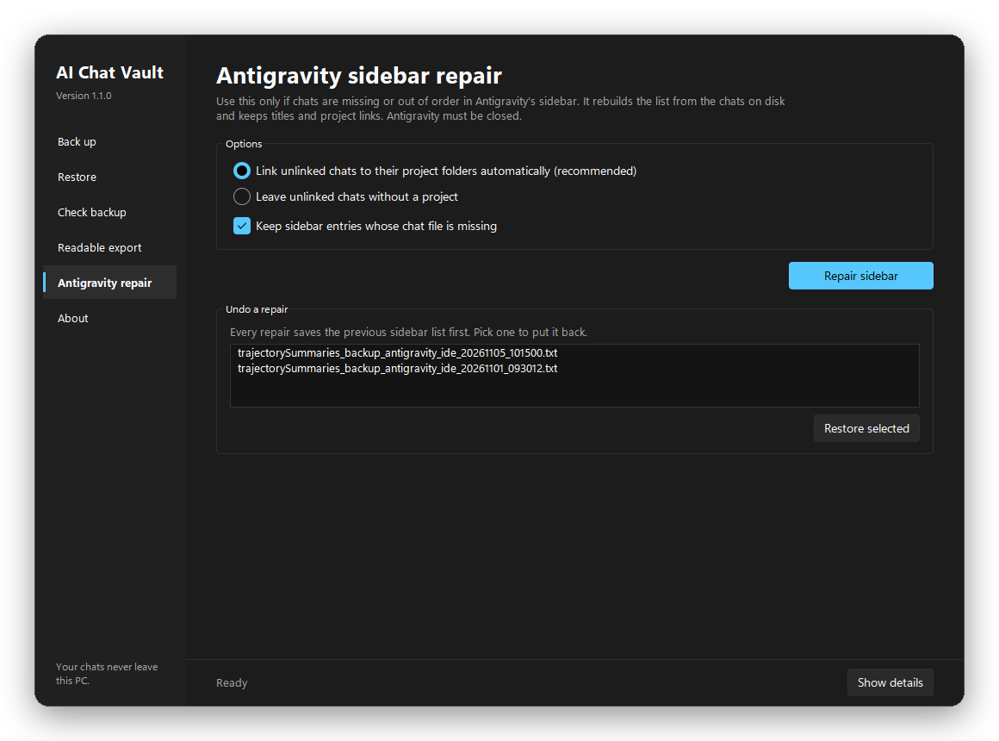<p align="center"><b>Antigravity repair</b> with undo</p></td>
</tr>
</table>

*Screenshots use demo data.*

## Quick start

### Download

From the [latest release](https://github.com/Tauquirshayaan/ai-chat-vault/releases/latest):

| File | What it is |
|---|---|
| `AI_Chat_Vault.exe` | The app window. Double-click it; nothing to install. |
| `AI_Chat_Vault_CLI.exe` | The same features as a text menu and command line. |

> [!NOTE]
> The executables are built from this repository by
> [GitHub Actions](.github/workflows/release.yml), so each release traces back
> to its source commit. They are not code-signed yet, so Windows may show
> **"Windows protected your PC"** for a downloaded copy: choose
> **More info → Run anyway**. On macOS and Linux, run the Python source
> (see [Build from source](#build-from-source)).

### Before you format

1. **Close** Antigravity, Codex (including its VS Code extension) and any
   terminal running Claude Code.
2. Open **AI Chat Vault** → **Back up**. Tick what to include, check the
   **Save to** folder, and click **Start backup**.
3. Save to a drive you are **not** formatting. The app suggests the non-Windows
   drive with the most free space and warns you if you pick `C:`.
4. Copy the finished zip to a **second place**: a USB drive or cloud storage.
5. Optional: open `readable/INDEX.md` inside the zip to see your chats.

> [!TIP]
> In each active project, also ask your agent to write a `PROJECT_CONTEXT.md`
> (goal, architecture, decisions, status, next steps) and push the repository
> to GitHub. It is the fastest way to brief any future agent.

### After you reinstall

1. Use the **same Windows user name**, and keep project drives on the **same
   letters**. Chats point to folders such as `D:\Projects\shop-api`.
2. Install Antigravity, Codex and Claude Code, sign in, open each once, then
   **close them completely**.
3. Open **AI Chat Vault** → **Restore**. Backups in `\AI-Chat-Backups` on any
   drive are listed automatically. Click **Preview changes**, then **Restore**.
4. Open your apps:
   - **Antigravity**: chats are back in the sidebar. If some are missing, use
     **Antigravity repair**.
   - **Codex**: `codex resume`
   - **Claude Code**: `claude --resume` inside the project folder

## How it works

### Backup

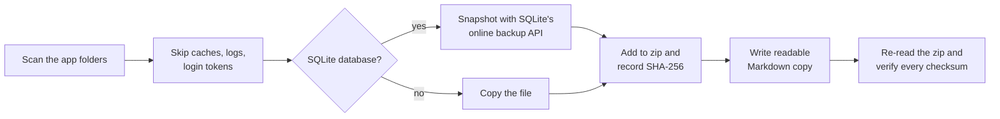

1. **Scan.** The app looks in the folders below and shows the size of each part
   before you start.
2. **Filter.** Caches, temporary files, logs, crash dumps and lock files are
   skipped. So are login tokens, unless you tick them.
3. **Copy safely.** Databases are snapshotted with SQLite's online backup API,
   so a database that is open, or has recent data in its `-wal` file, is still
   copied consistently.
4. **Record.** Each file is streamed into the zip while its SHA-256 checksum,
   original location and modification time go into `manifest.json`.
5. **Verify.** The finished zip is read back in full and every checksum is
   compared. An unfinished or cancelled backup is deleted, never left half-written.

### Restore

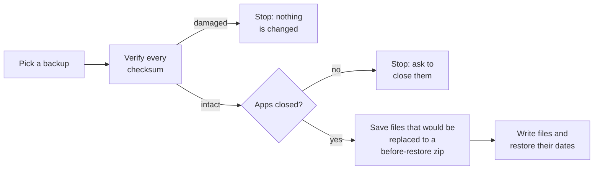

- Paths are stored relative to `{HOME}` and `{APPDATA}`, so a backup restores
  into whichever user folder you have now.
- Files you created after reinstalling are kept; only files in the backup are written.
- Stale `-wal`/`-shm` files next to a restored database are moved into the
  before-restore zip so they cannot corrupt it.
- Original modification times are restored, because the apps sort chats by them.

### What's inside a backup

```text
AI-Chat-Vault_<PC>_<date>.zip
├── manifest.json        checksums, original locations and dates of every file
├── README.txt           what this file is
├── files/
│   ├── antigravity-data/      ~/.gemini
│   ├── antigravity-ide-app/   %APPDATA%\Antigravity IDE\User
│   ├── antigravity-app/       %APPDATA%\Antigravity\User
│   ├── codex/                 ~/.codex
│   ├── claude/                ~/.claude
│   └── claude-config/         ~/.claude.json
└── readable/
    ├── INDEX.md               every chat, grouped by project folder
    ├── HOW_TO_CONTINUE.md     prompt to brief a new agent
    ├── antigravity/  codex/  claude/   one Markdown file per chat
    └── antigravity/brain/     the agent's plans, walkthroughs and reports
```

## What gets backed up

| App | Folder | Contents |
|---|---|---|
| Antigravity | `~/.gemini` | Conversations (`.db` and `.pb`), brain notes and transcripts, knowledge items, skills, MCP config, `GEMINI.md` |
| Antigravity | `%APPDATA%\Antigravity IDE\User`<br>`%APPDATA%\Antigravity\User` | Sidebar chat list (`state.vscdb`), project links (`workspaceStorage`), settings, keybindings |
| Antigravity | `~/.antigravity`, `~/.antigravity-ide` | Editor extensions *(optional)* |
| Codex | `~/.codex` | Sessions, thread history, memories, `config.toml`, `AGENTS.md`, skills, plugins |
| Claude Code | `~/.claude`, `~/.claude.json` | Transcripts, memory, `CLAUDE.md`, settings, skills, agents, hooks, plugins, MCP servers |

<details>
<summary><b>What is skipped, and why</b></summary>

| Skipped | Why |
|---|---|
| Login tokens (`~/.codex/auth.json`, `~/.claude/.credentials.json`) | A copied zip should not be able to sign anyone in. You sign in again after restoring, or tick **Login tokens**. |
| Antigravity browser-agent screenshots (`browser_recordings`) | Page images, often many GB. Optional. |
| Antigravity browser profile | Cookies and cache for the agent's browser |
| Caches, temp files, logs, crash dumps, lock files | Recreated by the apps |
| Codex sandbox binaries | Reinstalled by Codex |
| Claude app / claude.ai chats | Stored in your Anthropic account; they return when you sign in |

</details>

## Readable export

Each backup contains a `readable/` folder, and **Readable export** creates one
on demand. Every chat becomes a Markdown file with your messages, the agent's
replies, the tools it used, and the command to resume it:

```markdown
# Fix the failing payment webhook

- **Tool:** Codex
- **Project folder:** D:\Projects\shop-api
- **Continue it:** `codex resume 019a…`

### You
Why does the payment webhook fail on retries?

### Codex
The handler is not idempotent; I added an event-ID check.

*Tools used: shell ×3, apply_patch*
```

`HOW_TO_CONTINUE.md` contains a prompt that asks a new agent to read these
chats and write a `PROJECT_CONTEXT.md` for the project.

Antigravity chats are read from the agent's brain transcript when one exists,
otherwise from the `.db` conversation. Older encrypted `.pb` chats without a
transcript export their brain notes only; their raw files are still in the
backup, and Antigravity reads them again after a restore.

## Antigravity sidebar repair

If chats are missing or out of order in Antigravity's sidebar, **Antigravity
repair** rebuilds the list from the conversations on disk. Titles come from the
existing list, the agent's notes, or your first message, and chats are linked
to their project folders. The previous list is saved first and can be restored
from the same page.

<details>
<summary><b>Fixes compared with Antigravity Conversation Fix v1.07</b></summary>

This feature started from [Antigravity Conversation Fix](https://github.com/FutureisinPast/antigravity-conversation-fix) (MIT) and corrects:

- **Workspace links are kept byte-for-byte.** v1.07 misread the workspace
  field and rewrote any link containing `%20` or `%3A` into a corrupted value,
  dropping its repository and git details.
- **No overwritten rollback copies.** `Antigravity` and `antigravity` are the
  same folder on Windows; the database is now written once and backup names
  never collide.
- **Unreadable lists stop the repair** instead of being replaced by a list
  without titles or project links.
- **Missing chats are kept** in the list unless you choose otherwise.
- **All-or-nothing writes:** every database is backed up first and a failed
  write is rolled back.
- **Best copy wins:** when a chat exists in several folders, `.db` beats `.pb`,
  then the newest copy.
- A malformed link in a prompt no longer crashes title creation, and new
  project links use Antigravity's own format.

</details>

## Privacy and safety

- **Offline.** The app has no network code. Your chats never leave the drives
  you choose. (The About page has buttons that open this page in your browser.)
- **Read-only on your chats** when backing up or exporting.
- **Apps must be closed** to restore or repair, so they cannot overwrite the
  result when they exit.
- **Treat a backup as private.** It contains your conversations and project
  details, and MCP configuration files can contain API keys.

## Command line

`AI_Chat_Vault_CLI.exe` (or `python chat_vault_cli.py`) without arguments
opens a text menu. Every feature is also a command:

```bash
AI_Chat_Vault_CLI backup  --dest D:\AI-Chat-Backups [--only antigravity,codex,claude]
                          [--no-extensions] [--include-screenshots] [--include-logins]
AI_Chat_Vault_CLI verify  BACKUP.zip
AI_Chat_Vault_CLI restore BACKUP.zip [--only claude] [--dry-run] [--yes]
AI_Chat_Vault_CLI export  --dest D:\chats
AI_Chat_Vault_CLI repair-index [--auto] [--drop-missing]
AI_Chat_Vault_CLI undo-repair [BACKUP.txt]
AI_Chat_Vault_CLI list    # what a backup would include, with sizes
```

## FAQ

<details>
<summary><b>Will my chats work after restoring on a new PC?</b></summary>

Yes, as long as you use the same Windows user name and your project folders
are on the same drive letters. The apps store chats next to the folder paths
they belong to.
</details>

<details>
<summary><b>Can I back up while the apps are open?</b></summary>

Yes. Databases are still copied consistently, but a chat that is being written
at that moment may be cut short, so the app recommends closing them. Restore
and repair require the apps to be closed.
</details>

<details>
<summary><b>How big is a backup?</b></summary>

It depends on your history. Typical chat data is a few GB and compresses well.
The Back up page shows the size of every part before you start, and editor
extensions and browser screenshots are optional.
</details>

<details>
<summary><b>Does it back up my project code?</b></summary>

No. It backs up the agents' chats, memory and settings. Keep your code in Git
(for example on GitHub) and on a drive you are not formatting.
</details>

<details>
<summary><b>What about claude.ai, ChatGPT or Gemini web chats?</b></summary>

Those live in your online accounts and come back when you sign in. This app
covers the agents that store chats on your PC.
</details>

<details>
<summary><b>Windows says "Windows protected your PC". Is it safe?</b></summary>

The executables are unsigned, so Windows warns about downloaded copies. Each
release is built from this public source code by GitHub Actions. You can also
run the Python source directly.
</details>

## Build from source

Requires Python 3.8+.

```bash
git clone https://github.com/Tauquirshayaan/ai-chat-vault.git
cd ai-chat-vault
pip install sv-ttk                          # optional: Windows 11 style theme
python chat_vault.py                        # the window
python chat_vault_cli.py --help             # the command line

pip install -r requirements-build.txt       # PyInstaller and the theme
python -m unittest discover -s tests -t .   # run the tests
python -m PyInstaller AI_Chat_Vault.spec    # builds both .exe files in dist/
```

<details>
<summary><b>Project structure</b></summary>

```text
chat_vault.py              window entry point
chat_vault_cli.py          text menu and command-line entry point
chatvault/
├── gui.py                 desktop window (tkinter + sv-ttk)
├── cli.py                 text menu and commands
├── archive.py             backup, verify and restore engine
├── sources.py             which folders are backed up and what is skipped
├── export.py              readable Markdown export
├── antigravity_index.py   Antigravity sidebar repair
└── common.py              paths, running-app detection, helpers
tests/                     unit tests (run on Windows, macOS and Linux in CI)
assets/                    icon
docs/                      screenshots
```

</details>

## Contributing

Issues and pull requests are welcome. Please run the tests before opening a
pull request, and never include real chats or personal data in issues, tests
or screenshots.

## License

[MIT](LICENSE). The Antigravity sidebar repair is derived from
[Antigravity Conversation Fix](https://github.com/FutureisinPast/antigravity-conversation-fix) (MIT).

AI Chat Vault is an independent project and is not affiliated with Google,
OpenAI or Anthropic. Antigravity, Codex and Claude Code are trademarks of their
respective owners.
