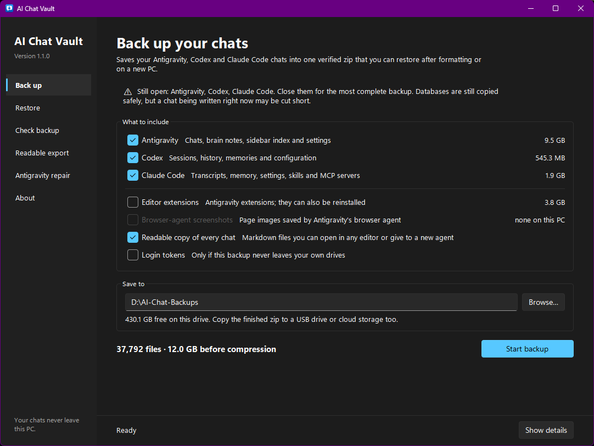

# AI Chat Vault

Back up your **Antigravity**, **Codex** and **Claude Code** chats before you
format or replace a PC, restore them afterwards, and keep a readable Markdown
copy of every conversation so a new agent can pick up your projects without
you explaining everything again.

It also includes a corrected version of the Antigravity sidebar repair from
[Antigravity Conversation Fix](https://github.com/FutureisinPast/antigravity-conversation-fix).



**Download** from the [latest release](../../releases/latest):

- `AI_Chat_Vault.exe`: the app window (double-click it)
- `AI_Chat_Vault_CLI.exe`: the same features as a text menu and command line

No installation and no Python needed on Windows. macOS and Linux can run the
Python source (3.8+); the window follows your light or dark mode.

The `.exe` is built from this repository by GitHub Actions
([workflow](.github/workflows/release.yml)), so every release can be traced to
its source commit. It is not code-signed yet, so Windows may show
"Windows protected your PC" for the downloaded file: choose
**More info → Run anyway**, or run the Python source instead.

## Before formatting

1. Close Antigravity, Codex (including the VS Code extension) and every
   terminal running Claude Code.
2. Open **`AI_Chat_Vault.exe`**. On **Back up**, tick what to include (sizes
   are shown), check the **Save to** folder and click **Start backup**.
3. Save to a drive you are **not** formatting. The tool suggests the
   non-Windows drive with the most free space and warns if you choose `C:`.
4. Copy the finished zip to a second place too (USB drive or cloud storage).
5. Open `readable/INDEX.md` inside the zip and check that your chats are there.

Optional but recommended: in each active project, ask the agent to write a
`PROJECT_CONTEXT.md` (goal, architecture, decisions, status, next steps) and
push the repository to GitHub.

## After reinstalling

1. Use the **same Windows user name** and keep project drives on the **same
   letters** (chats link to folders such as `G:\MyProject`).
2. Install Antigravity, Codex and Claude Code, sign in, open each once, then
   close them completely.
3. Open **`AI_Chat_Vault.exe`** → **Restore** and pick the backup (backups in
   `\AI-Chat-Backups` on any drive are listed automatically). Click
   **Preview changes** if you like, then **Restore**.
4. Open the apps. Antigravity shows its chats in the sidebar; use
   `codex resume` and `claude --resume` (inside the project folder) for the
   others. If some Antigravity chats are missing from the sidebar, use
   **Antigravity repair**.

## Pages

| Page | What it does |
|---|---|
| Back up | Choose tools and extras with live sizes, pick a folder, start. Creates `AI-Chat-Vault_<PC>_<date>.zip` and re-reads it to verify every checksum. Progress bar with Cancel. |
| Restore | Lists your backups, shows what each contains, previews changes, then restores the tools you tick; anything it replaces is saved first |
| Check backup | Verifies a zip without restoring it |
| Readable export | Writes every chat as Markdown, grouped by project folder |
| Antigravity repair | Rebuilds the sidebar list from the chats on disk, and undoes a repair |
| About | Privacy notes and the formatting checklist |

**Show details** at the bottom shows the full log of the current task.

## What is backed up

| Tool | Location | Contents |
|---|---|---|
| Antigravity | `~/.gemini` | Conversations (`.db`/`.pb`), brain notes and transcripts, knowledge, MCP config, `GEMINI.md` |
| Antigravity | `%APPDATA%\Antigravity IDE\User`, `%APPDATA%\Antigravity\User` | Sidebar index (`state.vscdb`), workspace links, settings |
| Antigravity | `~/.antigravity`, `~/.antigravity-ide` | Extensions *(optional)* |
| Codex | `~/.codex` | Sessions, thread history, memories, `config.toml`, `AGENTS.md`, skills, plugins |
| Claude Code | `~/.claude`, `~/.claude.json` | Transcripts, memory, settings, skills, agents, hooks, plugins, MCP servers |

Skipped automatically: caches, temporary files, logs, crash dumps, the
Antigravity browser profile, and Codex sandbox binaries. The Antigravity
browser-agent **screenshots** (`~/.gemini/*/browser_recordings`, JPG frames of the
pages the agent viewed) are left out by default; they can be many GB.

**Login tokens** (`~/.codex/auth.json`, `~/.claude/.credentials.json`) are not
included unless you say yes, so a copied zip cannot sign anyone in. You simply
sign in again after restoring.

Claude app and claude.ai conversations are stored in your Anthropic account
and come back when you sign in, so they are not part of this backup.

## How it keeps your data safe

- **Consistent databases.** SQLite files (`state.vscdb`, Codex databases,
  Antigravity `.db` chats) are copied with SQLite's online backup API, so
  data still sitting in `-wal` files is included even if an app is open.
- **Verified.** Every file's SHA-256 is stored in `manifest.json`; the zip is
  re-read after writing and again before restoring. A damaged zip is never
  restored.
- **Reversible restore.** Files a restore would replace — and stale `-wal`/`-shm`
  files beside restored databases — are first saved in an
  `AI-Chat-Vault_before-restore_<date>.zip`, which is itself restorable.
  Files created after reinstalling are left in place.
- **Original dates kept.** Modification times are restored, because the apps
  sort chats by them.
- **Apps must be closed** for restore and index repair; otherwise the app
  could overwrite the restored data when it exits.

## Readable export

`readable/` inside each backup (or option 4) contains:

- `INDEX.md` — every chat grouped by project folder, newest first
- `antigravity/`, `codex/`, `claude/` — one Markdown file per chat with your
  messages, the agent's replies, the tools it used, and how to resume it
- `antigravity/brain/<id>/` — the agent's plans, walkthroughs and reports
- `HOW_TO_CONTINUE.md` — a prompt that turns these chats into a
  `PROJECT_CONTEXT.md` for a new agent

Antigravity chats come from the brain transcript when one exists, otherwise
from the `.db` conversation. Older `.pb` chats are encrypted; without a
transcript only their brain notes are readable, but the raw files are still
backed up and the app reads them again after a restore.

## Changes to the Antigravity sidebar repair

Compared with Antigravity Conversation Fix v1.07:

- Existing workspace links are kept byte-for-byte. v1.07 misread the
  workspace field and rewrote any URI containing `%20`/`%3A` into a corrupted
  value, dropping its repository and git details.
- Folders that are the same on a case-insensitive disk (`Antigravity` and
  `antigravity`) are written once, and backup names never collide, so the
  first rollback copy is never overwritten.
- An index that cannot be decoded stops the repair instead of being replaced
  by one without titles or workspaces.
- Index entries whose chat file is missing are kept (use `--drop-missing` to
  remove them).
- All databases are backed up before any is written; a failed write is
  rolled back.
- When a chat exists in several folders, `.db` beats `.pb` and then the newest
  copy wins.
- A malformed link in a prompt no longer crashes title creation.
- New workspace links use Antigravity's own URI format.

## Command line

```bash
python chat_vault.py                      # window
python chat_vault_cli.py                  # text menu
python chat_vault_cli.py backup --dest D:\AI-Chat-Backups [--include-screenshots] [--no-extensions]
python chat_vault_cli.py verify  BACKUP.zip
python chat_vault_cli.py restore BACKUP.zip [--only antigravity,codex,claude] [--dry-run] [--yes]
python chat_vault_cli.py export  --dest D:\chats
python chat_vault_cli.py repair-index [--auto] [--drop-missing]
python chat_vault_cli.py undo-repair [BACKUP.txt]
python chat_vault_cli.py list
```

## Development

```bash
pip install -r requirements-build.txt         # PyInstaller and the sv-ttk theme
python -m unittest discover -s tests -t .
python -m PyInstaller AI_Chat_Vault.spec      # builds both executables in dist/
```

## Privacy

A backup contains your private conversations, project details and possibly
API keys stored in MCP configuration. Keep it on drives you control.

## License

MIT. The sidebar repair is derived from Antigravity Conversation Fix (MIT).
